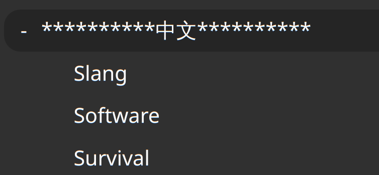
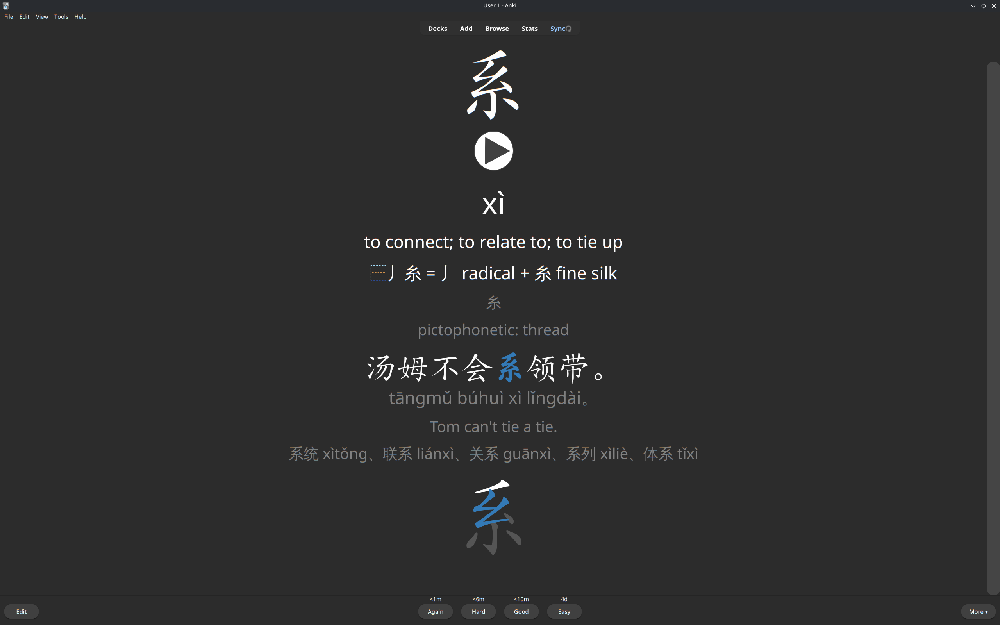
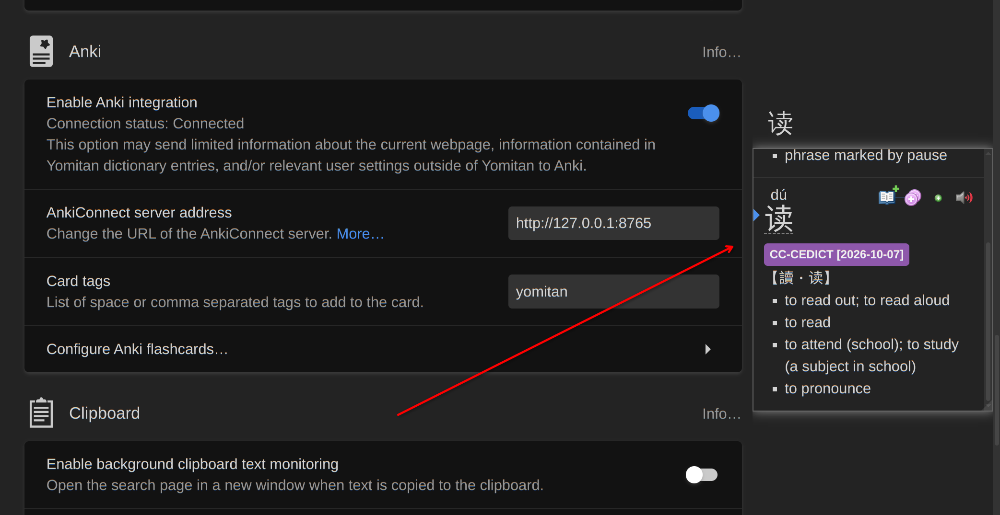
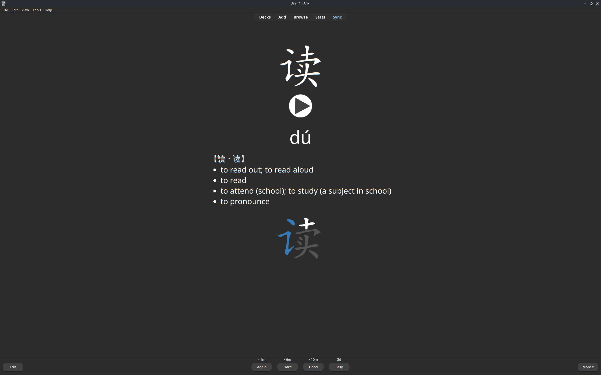

## 🎃 Halloween - Desafio 1

Oi, eu sou o Alisson ([@iamalisson](https://github.com/iamalisson)) e este é o espaço onde compartilho minha jornada de aprendizado durante o desafio **Halloween 2026**, realizado pelo [balta.io](https://balta.io). 👻

Aqui você vai encontrar projetos, exercícios e códigos que estou desenvolvendo durante o desafio.

### Sobre este desafio
Neste desafio o objetivo é consolidar os fundamentos do Spec Driven Development, criando uma constituição, especificação, planejamento e tarefas manualmente para serem implementadas pela IA posteriormente.

Em vez do gerador de senhas sugerido, apliquei o método num problema real meu: **migrar minha vida digital para o chinês**.

## Problema

Estou no nível HSK1 e quero usar o chinês como idioma padrão o quanto antes: no navegador, no Linux e nos
celulares. Já tentei com flashcards, mas não mantenho a constância: estudar "antes" para só depois usar o idioma não
motiva.

A virada veio da própria spec. Em vez de estudar primeiro e trocar depois, **troco primeiro e o Anki vira um kit de
sobrevivência** que ensina exatamente o que aparece na minha tela, sempre das partes para o todo (caractere, depois
palavra, depois frase).

## O que foi implementado

Um programa em Python (`src/zh.py`) que gera um pacote do Anki com três baralhos:



| Baralho | Cards | Conteúdo |
|---|---|---|
| **Survival** | 1641 | 783 caracteres (partes, radical, dica de origem, campo "Story" para sua história, animação dos traços), 828 palavras (textos do Brave + as 1000 mais frequentes) e 30 frases de menu do Brave |
| **Software** | 304 | Rótulos de configuração de Linux (KDE), Android, iPhone, mais datas e horas (星期一, 下午, 3分钟前, 昨天) |
| **Slang** | 729 | 400 gírias da internet (吃瓜, 躺平, 摆烂, 破防), 300 expressões idiomáticas (成语) e 29 ditados de duas partes (歇后语), com o sentido literal ao lado do real |

Os detalhes que fazem diferença:

- **Traduções oficiais.** Os textos do Brave saem dos arquivos de tradução do próprio navegador, os de Android dos
  arquivos oficiais do sistema, e os de Linux das traduções do KDE instaladas na máquina. Ou seja, o card mostra
  exatamente o que aparece na tela.
- **Partes antes do todo.** Cada caractere novo aparece logo antes da primeira palavra que o usa, e cada frase depois
  das palavras dela (verificado por teste).
- **Caminho de volta primeiro.** Os primeiros cards ensinam como voltar o idioma para o inglês em cada aparelho
  (系统, 语言, 系统设置, 区域和语言, 通用, 语言与地区). Trocar o idioma nunca vira armadilha.
- **Pinyin em tudo.** Exemplos, listas de palavras e decomposições vêm com pinyin, lido pelo contexto.
- **Reconstruir é seguro.** Gerar e importar de novo não duplica nada e preserva o histórico de revisões e as
  histórias escritas no Anki (verificado por teste).



### Mineração com o Yomitan

Para palavras encontradas navegando, uso o [Yomitan](https://yomitan.wiki/), um dicionário popup para o navegador.
Ele recebe o dicionário CC-CEDICT, e passar o mouse sobre uma palavra com Shift mostra pinyin e significado. Um clique
cria o card no Anki (pelo AnkiConnect), num baralho próprio com o mesmo visual dos outros cards.





O comando `uv run src/zh.py yomidict` gera um dicionário extra para o Yomitan: passar o mouse sobre um caractere
mostra de quais partes ele é feito e a sua história.

## Como usar

### Só os baralhos

Baixe o `zh-public.apkg` na [release mais recente](../../releases/latest) e importe no Anki (Arquivo > Importar).
Essa versão não inclui arquivos de áudio de terceiros: o próprio Anki lê cada card com a voz chinesa do aparelho
(AnkiDroid e iPhone já têm; no desktop depende de haver uma voz instalada).

Limites sugeridos: baralho pai com 15 cards novos por dia e ordem de coleta "Baralho"; Survival 8, Software 4,
Slang 3.

### Gerando você mesmo

Requer [uv](https://docs.astral.sh/uv/) e o Brave instalado.

```sh
uv run src/zh.py build --first-import --public   # gera build/zh-public.apkg
uv run src/test_zh.py                            # verificações (precisa de um build antes)
```

Sem `--public`, o build inclui áudio (de um baralho HSK de referência em `assets/`, se existir, e de TTS) e lê as
suas histórias do Anki antes de gerar, para nunca perdê-las. Os textos de Linux vêm das traduções do KDE instaladas
na sua máquina.

## Spec-Driven: como os arquivos guiaram a IA

| Arquivo | Papel |
|---|---|
| [constitution.md](specs/constitution.md) | Regras verificáveis: Python + uv, um programa só, biblioteca padrão primeiro, todo algoritmo com teste |
| [spec.md](specs/spec.md) | O quê e por quê, sem tecnologia: problema, histórias, RF-01..RF-13, regras de negócio, casos de borda, critérios de aceite |
| [plan.md](specs/plan.md) | O como, com cada decisão (D-01..D-21) e a justificativa do lado |
| [tasks.md](specs/tasks.md) | 28 tarefas pequenas, cada uma apontando de onde veio e com um "Concluída quando" verificável |
| [prototypes/](specs/prototypes/) | Os scripts da pesquisa de viabilidade que embasaram os números do plano |

Neste processo eu aprendi:
* Descrever o problema muda a solução: foi a frase "não tenho constância" que fez o projeto trocar "estudar antes" por "trocar primeiro".
* A spec diz o quê, não o como. Minha primeira versão mandava "abrir o navegador e copiar os textos"; descrever o resultado abriu espaço para usar as traduções oficiais.
* Premissas precisam ser verificadas: "1000 palavras = 80% da internet" na prática dá uns 62%.
* Tarefas pequenas, com origem e "Concluída quando", deixam a revisão objetiva: uma revisão encontrou 10 incoerências antes de qualquer linha de código.
* Toda decisão técnica com a justificativa ao lado evita refazer discussões.

## Créditos

CC-CEDICT (CC BY-SA 4.0), wordfreq (CC BY-SA 4.0), Make Me a Hanzi (LGPL-3.0), Tatoeba via manythings.org
(CC-BY 2.0 FR), strings do AOSP Settings/SystemUI (Apache-2.0), traduções do KDE (GPL/LGPL), Unicode CLDR via babel,
dados de traços do hanzi-writer (Arphic PL), [Yomitan](https://yomitan.wiki/). O baralho publicado segue a CC BY-SA
4.0 por causa das fontes. Algumas gírias são vulgares (o dicionário registra o uso real); suspenda a tag
`type::internet` se não quiser.

## Bagde


## Sobre o Halloween 2026
O desafio **Halloween 2026** consiste em implementar implementar o modelo Spec Driven Development de ponta a ponta, criando apps completas com IA.

### Veja meu progresso no desafio
https://github.com/balta-io/balta-desafio-halloween-2026-spec-driven-01
